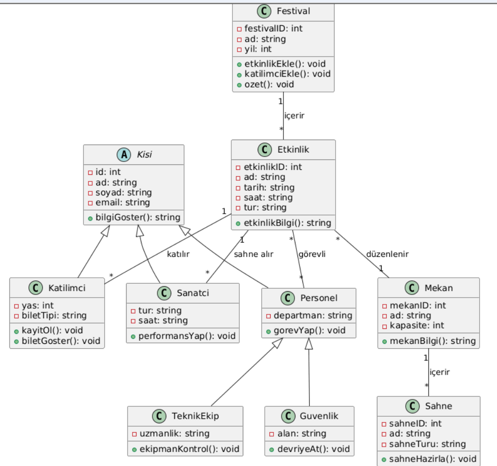

# 🎪 Festival Yönetim Sistemi

Python kullanılarak geliştirilen, nesne yönelimli programlama (OOP) prensiplerini temel alan Festival Yönetim Sistemi.

## 📌 Proje Hakkında

Bu proje, festival organizasyonlarında yer alan etkinliklerin, katılımcıların, sanatçıların ve personelin yönetimini modellemek amacıyla geliştirilmiştir.

Proje geliştirilirken Python programlama dili ve nesne yönelimli programlama yaklaşımı kullanılmıştır. Sınıflar arasındaki ilişkiler UML sınıf diyagramı ile tasarlanmıştır.

## 🛠️ Kullanılan Teknolojiler

- Python 3
- Nesne Yönelimli Programlama (OOP)
- UML Sınıf Diyagramı

## 📂 Proje Yapısı

```text
Festival-Yonetimi/
│
├── festival.py
├── UML-Diyagrami.png
└── README.md
```

## ⚙️ Uygulanan Özellikler

- Festival oluşturma ve festival bilgilerini görüntüleme
- Festivale etkinlik ekleme
- Festivale katılımcı ekleme
- Etkinlik bilgilerini görüntüleme
- Sanatçı performans bilgilerini görüntüleme
- Katılımcı ve bilet bilgilerini görüntüleme
- Mekân ve sahne bilgilerini yönetmeye yönelik sınıf yapıları
- Personel ve güvenlik görevlilerine ait sınıflar

## 🧩 Nesne Yönelimli Programlama

Projede kullanılan temel OOP kavramları:

- **Encapsulation (Kapsülleme):** Verilerin sınıflar içerisinde tutulması.
- **Inheritance (Kalıtım):** Katılımcı, Sanatçı ve Personel sınıflarının Kisi sınıfından türetilmesi.
- **Class & Object (Sınıf ve Nesne):** Festival, Etkinlik ve diğer sınıflardan nesneler oluşturulması.
- **Methods (Metotlar):** Sınıflara ait işlemlerin metotlar aracılığıyla gerçekleştirilmesi.

## 📐 UML Sınıf Diyagramı

Projenin sınıf yapısını, sınıflar arasındaki ilişkileri, kalıtım yapılarını ve çokluk (multiplicity) ilişkilerini gösteren UML diyagramı:



## ▶️ Nasıl Çalıştırılır?

1. Projeyi bilgisayarınıza indirin veya klonlayın.
2. Python 3 kurulu olduğundan emin olun.
3. Proje klasöründe terminali açın.
4. Aşağıdaki komutu çalıştırın:

```bash
python festival.py
```

## 🚀 Geliştirme Hedefleri

- Kullanıcı etkileşimli menü sistemi eklemek
- Veritabanı bağlantısı kurmak
- Etkinlik, katılımcı ve bilet işlemlerini geliştirmek
- UML diyagramındaki tüm sınıfları uygulamaya entegre etmek
- Projeyi daha kapsamlı bir festival yönetim otomasyonuna dönüştürmek

## 👨‍💻 Geliştirici

Python ve nesne yönelimli programlama kullanılarak geliştirilmiş bir eğitim projesidir.
